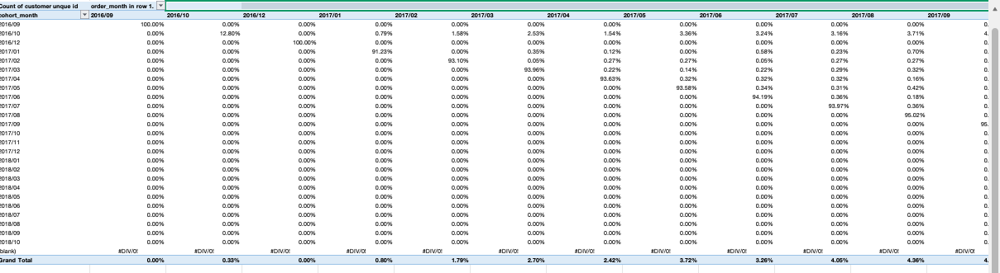

# Olist E-Commerce Customer Retention & Cohort Analysis

## Executive Summary
This project presents an end-to-end time-based cohort retention analysis conducted on ~99,000 transaction records from the Brazilian Olist E-Commerce dataset using WPS Spreadsheet. The analysis tracks customer re-engagement across monthly acquisition cohorts to evaluate long-term retention patterns and customer drop-off dynamics.

---

## Technical Workflow & Methodology
1. **Data Sanitization & Filtering:** Excluded terminal/invalid order statuses (`canceled`, `unavailable`) to eliminate false churn and preserve data integrity.
2. **Cohort Identification:** Derived initial customer acquisition months (`cohort_month`) using relational mapping and date transformation functions.
3. **Activity Timeline Mapping:** Mapped subsequent order dates (`order_month`) across transaction timelines to capture recurring purchases.
4. **PivotTable Matrix Construction:** Aggregated unique customer IDs (`Count of customer_unique_id`) and converted cell values into **% of Row Total** to construct the normalized retention matrix.

---

## Retention Matrix Deliverable

> **Data Source:** Raw dataset sourced from the publicly available [Olist E-Commerce Dataset on Kaggle](https://www.kaggle.com/datasets/olistbr/brazilian-ecommerce).

---

## Key Insights & Business Recommendations
* **Initial Acquisition Peak:** The baseline acquisition rate establishes at 100% in month zero for every cohort.
* **Month 1 Retention Drop-off:** Significant drop-off occurs within the first 30 days post-acquisition across most cohorts (e.g., `2016/10` retains 12.80% in month one before flattening).
* **Actionable Recommendation:** Implement automated post-purchase email flows and targeted loyalty incentives at the 14-day and 30-day post-purchase mark to improve initial customer re-engagement.
